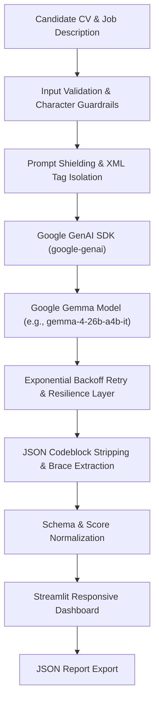

# 🎯 CVMatch AI — Gemma-Powered Resume & Job Alignment Intelligence

[](https://www.python.org/)
[](https://streamlit.io/)
[](https://ai.google.dev/gemma)
[](https://github.com/googleapis/python-genai)
[](https://opensource.org/licenses/MIT)

**CVMatch AI** is an open-source, evidence-grounded resume analysis assistant powered by Google's **Gemma** models via Google AI Studio. It objectively evaluates candidate qualifications against job requirements, isolating verified evidence from unmentioned criteria, and delivers actionable resume optimization recommendations.

---

## 🌟 Key Features

- **🎯 Estimated Alignment Score**: Calculates a transparent, evidence-based qualification score ($0-100\%$) indicating textual alignment between the CV and job posting (not a hiring probability).
- **📋 Executive Summary**: Synthesizes top strengths, role fit, and priority gaps in a clear narrative overview.
- **✅ Evidenced Skill Matches**: Pinpoints every requirement directly substantiated by the CV, complete with verifiable quotes and context.
- **⚠️ Potential Gaps Analysis**: Highlights job requirements not evidenced in the CV, helping candidates identify blind spots without falsely assuming complete lack of skill.
- **✍️ Targeted CV Improvements**: Provides structured "Action", "Original Context", and "Why it Helps" advice to strengthen bullet points.
- **💬 Interview Preparation**: Suggests high-signal questions an interviewer might ask to probe unverified skills or experience depths.
- **📂 One-Click Sample Testing**: Includes verified, realistic sample documents in `samples/` for immediate testing.
- **💾 JSON Export**: Allows downloading the complete analysis report in structured JSON format.

---

## 🏗️ Architecture & Pipeline



---

## 📁 Project Structure

```
CVMatch-AI/
├── .env.example             # Template for API keys and model configuration
├── .gitignore               # Ignored environments, caches, and secrets
├── LICENSE                  # MIT License
├── README.md                # Comprehensive project documentation
├── requirements.txt         # Core dependencies (streamlit, google-genai, python-dotenv)
├── app.py                   # Main Streamlit web application & Gemma pipeline
├── test_gemma.py            # Diagnostic script to test Gemma API connectivity
└── samples/                 # Verified sample documents
    ├── sample_cv.txt                # Realistic Junior Python Developer CV
    └── sample_job_description.txt   # Realistic Junior Python Backend Developer job description
```

---

## 🚀 Quickstart Guide

### 1. Prerequisites

- **Python 3.11** or newer
- **Git**
- A **Google AI Studio API Key** with access to Gemma models ([Get an API key here](https://aistudio.google.com/app/apikey))

### 2. Installation

#### Windows (PowerShell)

```powershell
# Clone the repository
git clone https://github.com/your-username/CVMatch-AI.git
cd CVMatch-AI

# Create and activate virtual environment
python -m venv .venv
.\.venv\Scripts\Activate.ps1

# Upgrade pip and install dependencies
python -m pip install --upgrade pip
pip install -r requirements.txt

# Create your .env configuration
Copy-Item .env.example .env
```

#### macOS / Linux (Bash)

```bash
# Clone the repository
git clone https://github.com/theholybeing/CVMatch-AI.git
cd CVMatch-AI

# Create and activate virtual environment
python3 -m venv .venv
source .venv/bin/activate

# Upgrade pip and install dependencies
pip install --upgrade pip
pip install -r requirements.txt

# Create your .env configuration
cp .env.example .env
```

### 3. Configure API Key

Edit `.env` and supply your Gemini API key:

```env
GEMINI_API_KEY=your_actual_api_key_here
GEMMA_MODEL=gemma-4-26b-a4b-it
```

> **Tip:** You can check which Gemma models are enabled on your account in Google AI Studio. Common models include `gemma-4-26b-a4b-it`, `gemma-2-27b-it`, or `gemma-2-9b-it`.

### 4. Verify API Connection

Run the diagnostic script to ensure your API key and model connectivity are operating correctly:

```bash
python test_gemma.py
```

Expected output:
```
Connecting to Gemma model 'gemma-4-26b-a4b-it' via Google AI Studio...
✅ Connection successful!
Model: gemma-4-26b-a4b-it
Response:
An API, or Application Programming Interface, is a set of rules...
```

### 5. Launch the Web Application

```bash
streamlit run app.py
```

Open your browser to the local URL (typically **http://localhost:8501**).

---

## 🧪 Testing with Sample Data

For instant evaluation without finding a resume:
1. Open the running web app.
2. Click **📥 Load Sample (Junior Python Dev)** above the form or in the sidebar.
3. Click **🚀 Analyze Alignment with Gemma**.
4. Review the generated score, evidence breakdown, improvement points, and interview questions.

---

## 🛡️ Responsible AI & Security

- **Prompt Injection Defense**: Input CVs and job specifications are isolated within `<cv>` and `<job>` delimiters and treated strictly as untrusted data rather than system instructions.
- **Strict Evidence Grounding**: The system prompt prohibits hallucinating qualifications, degrees, or experience not explicitly evidenced.
- **Fairness & Bias Mitigation**: The system explicitly forbids inferring or evaluating protected personal characteristics (gender, race, age, religion, nationality).
- **Decision Support, Not Automated Hiring**: The alignment score indicates approximate textual overlap and evidence coverage. It **must not** be used as an automated hiring decision-maker.
- **Credential Protection**: `.env` and local secrets are excluded from version control via `.gitignore`.

---

## 📜 License

- **Application Code**: Licensed under the [MIT License](LICENSE).
- **Gemma Models**: Subject to the [Gemma Terms of Use](https://ai.google.dev/gemma/terms).
